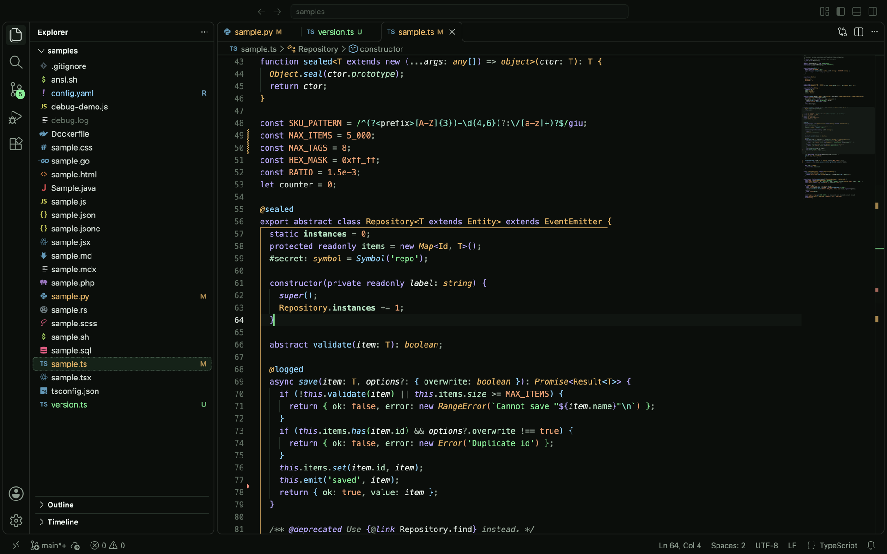
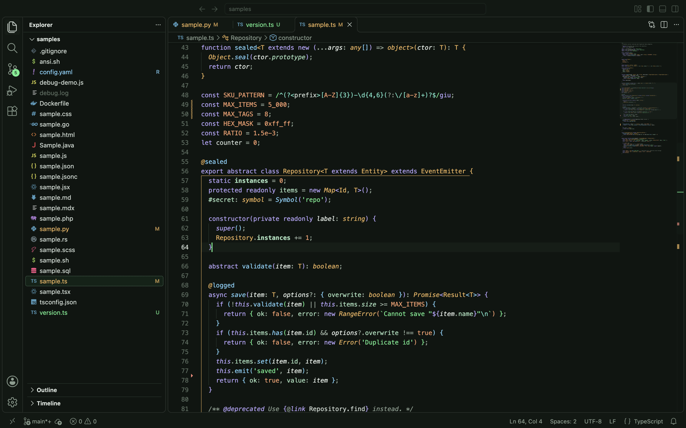
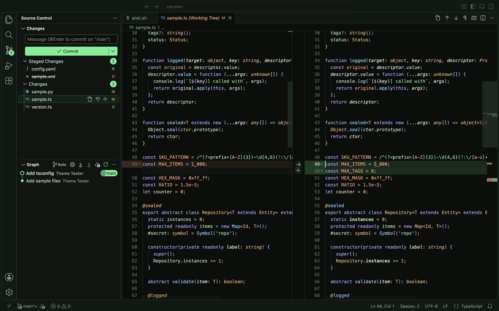
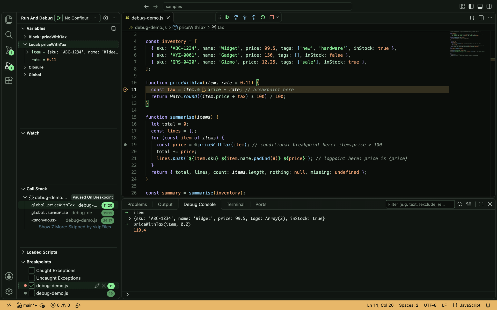

## Problem

My personal site, NubiBuilds, has a fixed palette: a green-tinted near-black background, one green accent, and four supporting colours. I spend most of my day in VS Code, and I wanted the editor to feel like the same place. I did not want something "inspired by" the site. I wanted the same hex values.

A VS Code colour theme looks like a small job: one JSON file. In practice that file has **971 possible workbench colour IDs**, plus token rules for syntax and semantic highlighting. Any ID you leave out falls back to VS Code's default, so a theme set by hand tends to show patches of stock blue and grey in places you rarely open: the merge editor, the debug toolbar, test coverage.

The harder problem is transparency. Selection, search matches, diff lines and the debug execution line are all drawn as semi-transparent layers *over* the code, and some of them stack. A comment that reads fine on the plain background can drop below WCAG's 4.5:1 once it sits under a selection on the current line. You cannot see that from the JSON, and you will rarely catch it by eye.

**Constraints**

- One person, about two days, from first commit to release.
- The site's base colours were fixed. I could add derived colours and tune transparency, but not change the background, text or accent.
- Every text colour had to reach 4.5:1 and every UI indicator 3:1 (WCAG 2.1 AA), on every surface and under every highlight.
- No npm dependencies to install. The build runs on plain Node.

## Architecture

The theme files are not written; they are generated. A single script, `scripts/build-theme.mjs`, holds the palette, the transparency values and every colour rule. It writes three theme files. Two check scripts then read those *built* files, so the thing that gets verified is exactly the thing that ships. If either check fails, packaging stops.

```text
  scripts/build-theme.mjs
  ├── palette   30 colours, defined once
  ├── alpha     strength of each transparent layer
  └── rules     837 colour IDs, 54 token rules,
                46 semantic token rules
            │  npm run build   (once per variant)
            ▼
  themes/*.json   Dark · Dark Void · Dark Float
            │  npm run check
            ▼
  check-contrast.mjs   1,277 pairs per theme
  check-coverage.mjs   IDs vs. 971 official IDs
            │  any failure → exit 1
            ▼
  vsce package  →  nubibuilds-dark-0.1.2.vsix
```

### One accent, four colours with fixed jobs

The palette is small on purpose. Each supporting colour does the same job everywhere: in syntax, in the workbench and in the terminal.

| Colour | Hex | Job |
| --- | --- | --- |
| Accent green | `#62f08f` | Focus, cursor, active state, strings, success, added |
| Amber | `#f0b45a` | Types, warnings, search matches, modified |
| Cyan | `#7fd4ff` | Functions, links, information, renamed |
| Coral | `#ff8a7a` | Errors, deleted, HTML tags |
| Violet | `#b9a6ff` | Keywords, merge conflicts |

Orange, mint and teal were derived for numbers, properties and regular expressions. Colour is never the only signal: comments, parameters and built-ins are italic, deprecated symbols are struck through, and active tabs and panels carry an accent line.

### A generator script, not a hand-edited JSON file

- **Why:** One palette feeds three variants, 837 IDs, the TextMate rules and the semantic rules. Changing a colour is one edit, and the build refuses duplicate IDs and malformed hex values.
- **Cost:** The files in `themes/` are build output. Anyone who edits them by hand loses the change on the next build, so the README says so in its first development paragraph.

### Three variants from the same rules

The extension ships three themes that share every colour rule and differ only in how backgrounds are layered.

| Theme | Backgrounds |
| --- | --- |
| **Dark** | Editor darkest; side bar, panel and terminal one step lighter; bars a third shade |
| **Dark Void** | Everything on the darkest background, separated by lines only |
| **Dark Float** | Editor raised to the side bar's shade; highlights weakened to keep contrast |





- **Why:** People disagree about panel contrast, and the cost of a variant is a dozen lines of overrides, not a second theme to maintain.
- **Cost:** Every check runs three times. Float needed its own transparency table (below), because raising the editor background leaves less room for highlights.

### Checked against the official list, not memory

`scripts/official-color-ids.json` is a snapshot of the 971 IDs in the Theme Color Reference, taken on 14 November 2026. The coverage check rejects any ID that is not in it, confirms 500 required IDs across 12 areas, and fails if any colour value does not come from the palette.

- **Why:** VS Code silently ignores IDs it does not know. A typo, or an ID from an older version, simply does nothing.
- **Cost:** The snapshot ages. 64 newer IDs (`agents*`, `modern*`) are left at their defaults, because I could not see what they colour well enough to judge them.

## Implementation

### Measuring contrast where the text actually sits

The first version followed the original spec: selection at about 18%, the active search match at about 32%, diff lines at about 14%. Everything looked fine on screen. Then I wrote the contrast check, and it failed.

The check does not compare a colour with the background. It first composites every transparent layer, in order, onto the background the text is really drawn on. It does this on the plain editor background and on the current-line highlight, which is the lighter one and therefore the worst case. Then it tests all 12 syntax colours on the result.

```js title="scripts/check-contrast.mjs"
/** Composite `layers` (bottom to top, may have alpha) onto an opaque base. */
function composite(base, ...layers) {
  let out = parse(base);
  for (const layer of layers) {
    const l = parse(layer);
    out = {
      r: out.r + (l.r - out.r) * l.a,
      g: out.g + (l.g - out.g) * l.a,
      b: out.b + (l.b - out.b) * l.a,
      a: 1,
    };
  }
  return toHex(out);
}

// Code is drawn on the editor background and on the current-line highlight.
for (const [label, layers] of overlays) {
  for (const [baseName, base] of codeBases) {
    const under = composite(base, ...layers.map(id));
    for (const c of syntaxColours) {
      check('Syntax on overlays', `${c} on ${label} (${baseName})`, contrast(p[c], under), 4.5);
    }
  }
}
```

35 overlays × 2 backgrounds × 12 colours, plus the terminal selection, gives 854 checks for this group alone. Stacked layers are listed as a single overlay, for example a diff line plus the changed-word highlight on top of it.

What it found, and what I changed:

| What | Spec | Shipped | Why |
| --- | --- | --- | --- |
| Editor selection | ~18% | 15% | Comments under a selection on the current line fell below 4.5:1 |
| Active search match | ~32% | 17% + solid amber border | At 32%, comments dropped to about 3.3:1. The border now does the distinguishing |
| Diff line + changed word | ~14% | 9% + 6% | The two layers stack; the sum has to pass |
| Debug execution line | ~18% | 16% | 18% gave 4.44:1 for comments |
| `muted` (inlay hints) | `#6f8375` | `#768b7c` | Only 4.25:1 on its own hint background |
| `borderStrong` | `#4a6a56` | `#4f715c` | Secondary button border was 2.86:1, under the 3:1 for UI |

> [!NOTE]
> Rounding matters. In Float, selection was planned at 12%. Written as an 8-bit hex alpha it rounds to `#62f08f1f`, which gives comments 4.49:1. One step down, 11.5%, passes. You only find that by checking the value that ships, not the value you meant.





### Keeping categories apart

Readable is not the same as distinguishable. The check also converts the main syntax colours to CIE Lab and requires a distance (ΔE76) of at least 12 between every pair of categories. The closest pair is types (amber) and numbers (orange) at 21.2, comfortably clear.

### Testing in the real editor

Numbers prove contrast, not taste. `TESTING.md` lists 15 manual steps (T0–T14), one per area: workbench, Explorer, editor, syntax in 21 languages, semantic highlighting, terminal, search, Source Control, debugging, widgets, accessibility. Each step says what to open, what should be visible, and what counts as a failure. The `samples/` folder has a realistic file per language, an ANSI colour script and a script that builds a Git repository with every file status. I ran all steps in the Extension Development Host on 14 November for all three themes, and recorded no findings.

### Built with Claude Code

Most of the generator and the check scripts were written with Claude Code. I wrote the spec and the palette, made the design calls (three variants, the trade-offs above), and did the manual testing myself.

**Milestones**

1. 14 Nov: NubiBuilds Dark built exactly to the original spec, tagged `baseline-spec`.
2. 14 Nov: Dark Void and Dark Float added; every check now runs once per variant.
3. 14 Nov: manual tests recorded, previews for 20 languages rendered, MIT licence added; v0.1.0 published on the VS Code Marketplace at 23:55.
4. 15 Nov: extension icon and a polished Marketplace description, released as v0.1.1 on the Marketplace and on GitHub.
5. 26 Nov: v0.1.2 on the Marketplace and on GitHub, a documentation-only release: Marketplace install steps in the README, the language previews linked, and a cover whose five dots show the accent and the four supporting colours. The themes are unchanged.

## Result

NubiBuilds Dark v0.1.2 is live on the [VS Code Marketplace](https://marketplace.visualstudio.com/items?itemName=danaharliansyah.nubibuilds-dark), so it installs from the Extensions view: search for NubiBuilds Dark, or open Quick Open (<kbd>Ctrl</kbd>/<kbd>Cmd</kbd> + <kbd>P</kbd>) and run `ext install danaharliansyah.nubibuilds-dark`. The same release is [on GitHub](https://github.com/nubibuilds/nubibuilds-vscode-theme/releases/tag/v0.1.2) as a single `.vsix` of about 46 KB with all three themes. The screenshots on this page were taken with v0.1.1, whose themes are identical, installed in VS Code 1.148.[^1]

- **1,277 contrast checks per theme, 0 failures**, in all three themes: 162 text-on-surface pairs, 854 syntax-on-overlay pairs, 57 UI indicators, 167 UI text pairs, 28 category distances and 9 documented exceptions.[^2]
- **4.51:1** is the lowest text contrast anywhere: comments under a symbol highlight on Float's current line. Dark and Void bottom out at 4.54:1.
- **837 of 971** official colour IDs are set in each theme. Each of the other 134 is left default on purpose, with the reason written down: high-contrast-only borders, foregrounds that would erase syntax colours under a highlight, optional borders whose default is "none", and the 64 new IDs I have not judged.
- **54 token rules** with 240 scope selectors, and **46 semantic token rules** that the check compares against them, so TextMate and semantic highlighting never disagree.

The bigger change is how I work on it. Adjusting a colour now means one edit and `npm run check`. If anything gets worse, the output names the pair and the ratio, and the build refuses to package.

What I cannot measure yet is whether anyone else uses it. The listing went live on 14 November; install counts over the next few months will tell.

**What I would do next**

- Publish to Open VSX as well, so editors built on VS Code without Marketplace access, such as VSCodium, can install it.
- Judge and colour the 64 new `agents*` and `modern*` IDs, and refresh the ID snapshot on a schedule instead of by hand.
- Make the scrollbar easier to find: at rest it is 1.24:1, a deliberately faint `line` colour, below the 3:1 for UI components.
- Consider a High Contrast variant. Today the theme leaves `contrastBorder` unset, so VS Code's own HC themes are unaffected, but there is no NubiBuilds HC.

## Lessons learned

- **Measure the composited colour, at the worst position.** A highlight's alpha means nothing on its own. What matters is the colour under the text after every layer is applied, on the lightest background the text can appear on.
- **Check the artefact, not the intent.** Reading the built JSON instead of the source values is what caught the 12% → 4.49:1 rounding case.
- **A small palette is easier to check.** Five working colours with fixed jobs left only 28 category pairs to keep apart, and made the theme easier to read.

[^1]: Taken on 26 November 2026 in a clean VS Code 1.148 profile with the v0.1.1 `.vsix` installed (v0.1.2 changes only the documentation), on a copy of the repository's `samples/` folder. TypeScript diagnostics were turned off so that sample-only type errors do not distract from the colours.

[^2]: From `npm run check` on commit `5fdaac9`, 26 November 2026. The nine exceptions are held to 3:1 instead of 4.5:1: line numbers, whitespace and ignored files (`faint`) on each surface, and ANSI bright black under the terminal selection.
