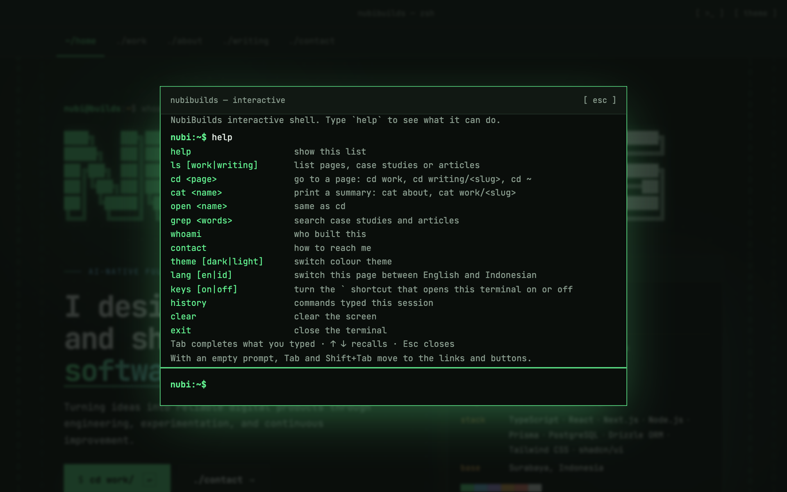
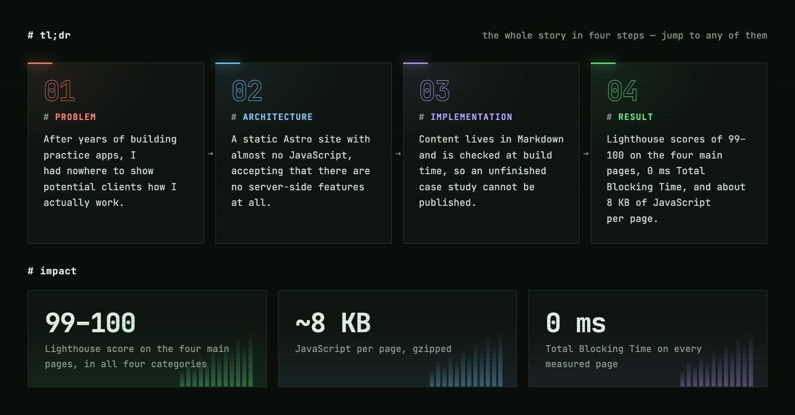
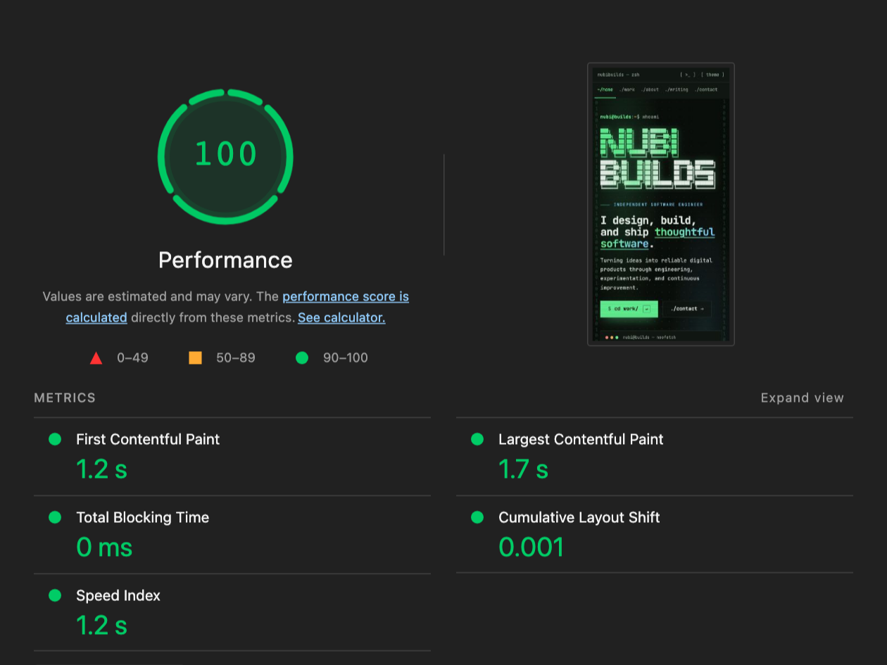

## Problem

I wrote my first lines of code at university in 2020. I have built a lot of apps since then, most of them from tutorials: one project, one new idea, then on to the next. All of it sat in repositories that hardly anyone ever looked at.

Now that I take on freelance work, that became a real gap. When a potential client asks "what have you built, and how did you go about it?", a GitHub link does not answer the question. A list of repositories shows what exists, not why any decision was made.

There is no shortage of portfolio templates. Most of them look alike, lean heavily on JavaScript, and are not designed for long-form writing. What I needed was a place to tell the story: what the problem was, what I chose, and how it turned out.

One more requirement: some of the people I work with read Indonesian, some read English. Case studies and articles had to work in both languages without me running two sites.

**Constraints**

- I work on it alone, between other projects. Keeping it up to date cannot take much time.
- It has to be hostable as plain static files, with no server to run or pay for.
- It has to be fast on a phone and fully usable with a keyboard. A developer portfolio that fails at the basics is evidence of the wrong kind.

## Architecture

The shape is simple. All content is Markdown, Astro turns it into static HTML at build time, and Cloudflare Pages serves the result. No database, no API, no running server. The rule I hold to: every page must still read in full with JavaScript turned off.

```text
  src/content/{work,writing}/{en,id}/*.md
                   │
                   ▼
  content.config.ts   schema + structure check
                   │   (fails → the build stops)
                   ▼
  astro build
                   │
                   ▼
  dist/   static HTML, ~8 KB of JS per page
          + search.json, rss.xml, sitemap.xml, og/*.png
                   │
                   ▼
  Cloudflare Pages ──► browser
                       ├── theme, terminal, search
                       └── no JS: content still reads
```

The interactive parts are extras. The terminal is a plain `<dialog>` element with 17 commands (`ls`, `cd`, `grep`, `theme` and more), opened with <kbd>Ctrl</kbd> + <kbd>K</kbd>. Search reads a `search.json` built with the site, and only downloads it the first time someone searches.



### Astro and static HTML, not Next.js

Next.js is what I use day to day, so it was the obvious first thought. But this site is almost entirely text. Shipping the React runtime to the browser just to show paragraphs felt like the wrong trade.

| Option | Strength | Why not |
| --- | --- | --- |
| Next.js | The tool I know best | Ships the React runtime for content that never changes |
| Portfolio template | Quick to launch | Hard to change, not made for long-form writing |
| Astro | Plain HTML, JavaScript only where asked for | Chosen |

- **Why:** Astro outputs plain HTML by default. The small scripts I wrote myself are inlined into the page, with no framework in the browser.
- **Cost:** No server-side features. Contact is by email, and search runs in the browser from a JSON index. For a few dozen entries that is plenty. If it ever reaches hundreds, the approach needs another look.

### One folder per feature

The code is split by feature: `home`, `work`, `writing`, `about`, `contact`, `terminal` and `search`. Pages in `src/pages` only put those features together. One rule I keep strictly: a feature never imports another feature. Anything shared lives in `shared`.

- **Why:** When I want to change the terminal, I know exactly which folder to open, and nothing else breaks along the way.
- **Cost:** `shared` tends to grow. Every so often I go through it and move code back into the one feature that actually uses it.

### The file name decides the translation

English files live in `en/`, Indonesian ones in `id/`. Two files with the same name are treated as translations of each other. The language switch, the sitemap and the `hreflang` tags for search engines all follow from that, with no extra configuration.

- **Why:** No i18n library, no mapping table. Copy the file and translate it.
- **Cost:** Keeping the two versions in step is on me. The home and About pages are English only for now.

## Implementation

### A build that refuses half-finished content

I know my own habits: copy a template, fill in half of it, forget the rest. So the rules for writing a case study could not just live in the docs. The build itself had to say no.

The frontmatter is checked by a Zod schema in `content.config.ts`. An empty required field, or a `TODO` marker left over from the template, fails the build. The body is checked too: it must open with four `##` sections (Problem, Architecture, Implementation, Result) and may not contain a `#` heading. The error names the file and what to fix:

```text
src/content/work/en/nubibuilds: the body has 3 "##" section(s);
it must start with 4: Problem, Architecture, Implementation,
Result (Masalah, Arsitektur, Implementasi, Hasil). Fix it, or
set draft: true.
```

There is one small trap. A comment like `# install dependencies` inside a shell code block looks exactly like a heading. So lines inside code blocks are skipped before any headings are counted.

Files with `draft: true` are exempt. A draft can stay messy for as long as it needs to, and only shows up in `pnpm dev`.

The strictness pays off. Because every case study has the same four parts, the page can build its own "tl;dr" from the frontmatter, with consistent numbers and colours, and each step links to its section.



### Keyboard focus that slipped off screen

The bug that kept me most curious was a small one. To save the browser work, every section below the first screen used `content-visibility: auto`. The browser skipped laying out a section until it was nearly in view, and assumed it was 640px tall in the meantime.

Then one of the accessibility tests started failing, but not every time. The test is simple: press <kbd>Tab</kbd> again and again, and check that every focused element is on screen. Sometimes it passed, sometimes it did not.

The cause was that height estimate. When focus moved into a section that had not been laid out yet, the browser scrolled based on 640px. Once the real height was known, the focused element had been pushed below the fold. A keyboard user lost track of where they were, which fails WCAG 2.4.11.

The fix was a few lines. Two frames after focus moves, once layout has settled, the element's position is checked again. If it is out of view, it is scrolled back:

```ts {4-5,8-9}
document.addEventListener('focusin', (event) => {
  const target = event.target;
  if (!(target instanceof HTMLElement) || !target.closest('.section')) return;
  requestAnimationFrame(() =>
    requestAnimationFrame(() => {
      if (document.activeElement !== target) return;
      const rect = target.getBoundingClientRect();
      if (rect.top >= window.innerHeight || rect.bottom <= 0)
        target.scrollIntoView({ block: 'nearest' });
    }),
  );
});
```

> [!NOTE]
> The "wholly out of view" condition matters. A long code block is often only partly visible, and that is fine. If every partly hidden element were scrolled, the page would jump on every press of <kbd>Tab</kbd>.

I adjusted the test as well: it re-measures an element for up to 500 ms before calling it off screen. It has been stable since.

In the end, `content-visibility` went altogether, and the fix above with it. Scrolling felt choppy, so I measured what the setting actually saved. It cost more than it gave. On a phone, the about page grew by about 1,500px while it was scrolled, as each section swapped the 640px estimate for its real height. Every section that came back on screen also had to be drawn again from scratch. Without it, scrolling the home page takes about 45% less raster work, and focus has nothing left to slip on.

### Built with Claude Code

Most of this site's code was written together with Claude Code. I set the direction, the rules and the limits, and I review every change before it is committed. Claude does much of the repetitive work and helped track down bugs like the focus issue above. The end-to-end tests and the Lighthouse budgets in CI make sure that speed does not come at the cost of quality.

**Milestones**

1. Mid-November 2026: the site's skeleton, two languages, the terminal, search, social preview images, RSS and the sitemap.
2. 20 November: the first commit, with Playwright tests, axe-core scans and Lighthouse budgets in GitHub Actions.
3. 21 November: sample content removed, the build starts refusing unfinished case studies and articles, and the focus bug is fixed.
4. 22 November: this case study goes live, the first one through those checks.

## Result

The site is live at nubibuilds.dev. The numbers:

- Lighthouse scores of **99–100** for performance, accessibility, best practices and SEO on the home page, `/work`, `/writing` and `/about`.[^1] The only 99 is performance on the About page, which carries the ASCII portrait.
- **0 ms Total Blocking Time** on all four. LCP ranges from 0.9 s (`/work` and `/writing`) to 1.8 s (`/about`).
- About **8 KB of JavaScript** per page, gzipped and inlined in the HTML. There are no external script files to download.[^2]
- **39 end-to-end tests**, each run at desktop and phone sizes, including an axe-core scan of every page in both the dark and light themes.



For me, the biggest change is not in the numbers. Adding a case study now means copying a template, filling it in and running `pnpm build`. If something is missing, the build says which file and which field.

What I cannot measure yet is the thing that matters most: whether the site actually brings in clients. That will take a few months to tell.

**What I would do next**

- Write case studies for other projects, so `/work` is not only about this site.
- Watch INP and TTFB from real visitors in Cloudflare Web Analytics. Neither can be measured by Lighthouse on a local machine.
- Translate the home and About pages into Indonesian.

[^1]: Measured with Lighthouse CI (`pnpm lighthouse`) on a production build on a local machine, three runs per page, 20 November 2026.

[^2]: Measured from `dist/` after `pnpm build`: the total content of the `<script>` tags on the home page, `/work` and `/about`, gzipped: 7.2–7.8 KB.
