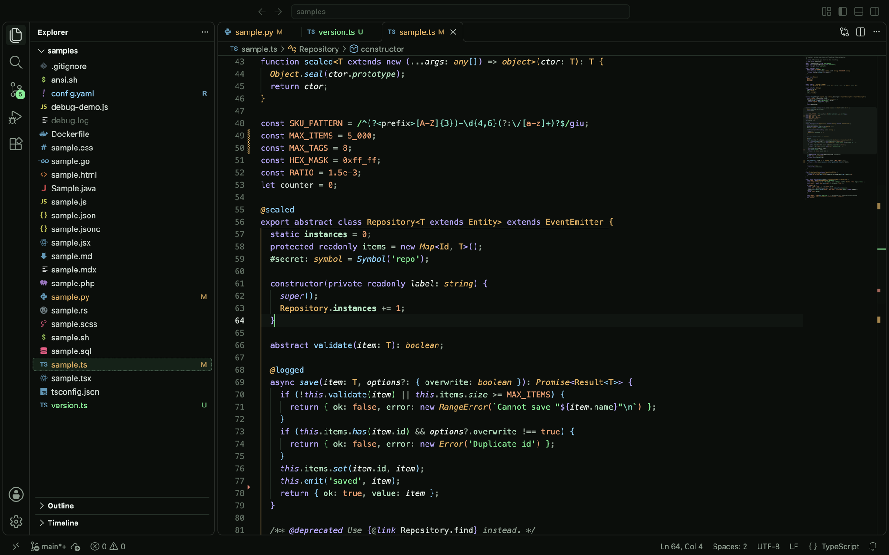
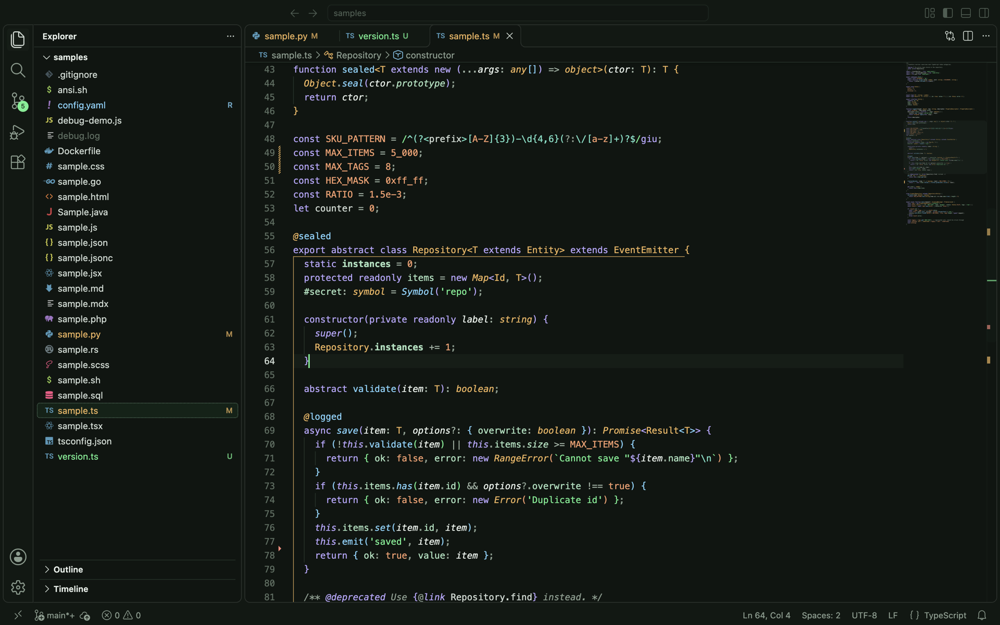
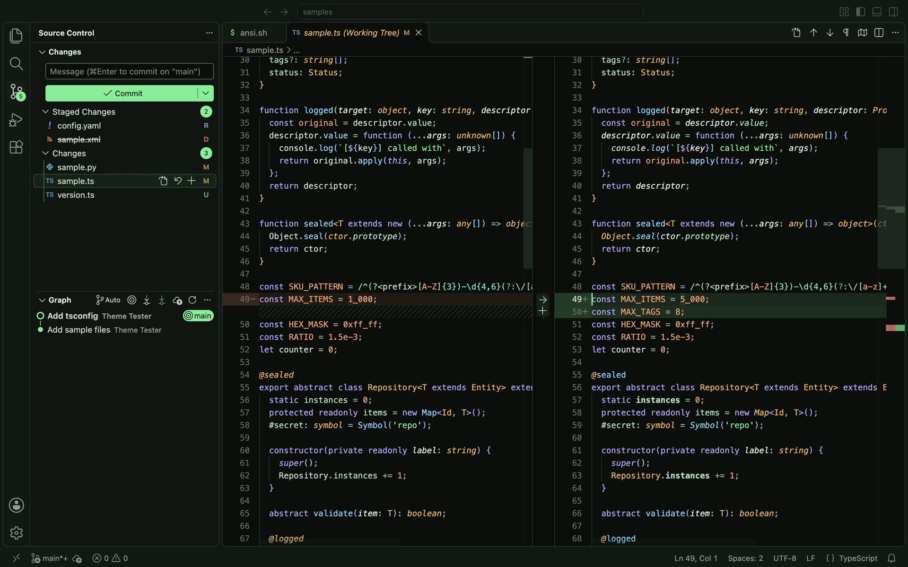
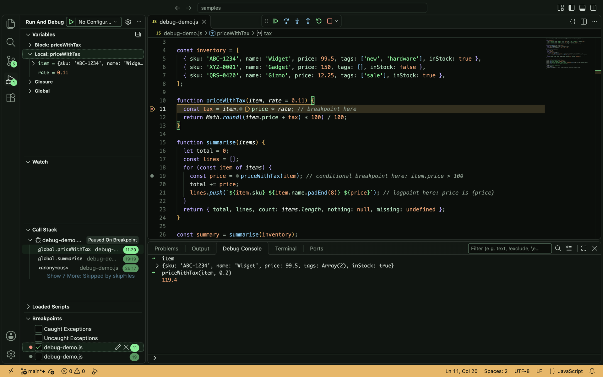

## Masalah

Situs pribadi saya, NubiBuilds, punya palet yang tetap: latar hampir hitam bernuansa hijau, satu aksen hijau, dan empat warna pendukung. Sebagian besar hari saya habiskan di VS Code, dan saya ingin editor terasa seperti tempat yang sama. Bukan sekadar "terinspirasi" dari situs, tetapi memakai nilai hex yang sama persis.

Tema warna VS Code kelihatannya pekerjaan kecil: satu file JSON. Kenyataannya, file itu punya **971 kemungkinan Color ID workbench**, ditambah aturan token untuk syntax dan semantic highlighting. ID yang tidak ditetapkan kembali ke warna bawaan VS Code. Akibatnya, tema yang disusun tangan sering menyisakan bercak biru dan abu-abu bawaan di tempat yang jarang dibuka: merge editor, toolbar debug, coverage tes.

Masalah yang lebih sulit adalah transparansi. Seleksi, hasil pencarian, baris diff, dan baris eksekusi debug semuanya digambar sebagai lapisan semi-transparan *di atas* kode, dan sebagian bisa bertumpuk. Komentar yang terbaca jelas di latar biasa bisa turun di bawah 4,5:1 versi WCAG begitu berada di bawah seleksi pada baris aktif. Hal itu tidak terlihat dari JSON, dan jarang tertangkap oleh mata.

**Batasan**

- Satu orang, sekitar dua hari dari commit pertama sampai rilis.
- Warna dasar situs tidak boleh diubah. Saya boleh menambah warna turunan dan mengatur transparansi, tetapi tidak mengubah latar, teks, atau aksen.
- Setiap warna teks harus mencapai 4,5:1 dan setiap indikator UI 3:1 (WCAG 2.1 AA), di semua permukaan dan di bawah semua sorotan.
- Tanpa dependency npm yang perlu diinstal. Build berjalan di Node biasa.

## Arsitektur

File tema tidak ditulis, tetapi dihasilkan. Satu skrip, `scripts/build-theme.mjs`, menyimpan palet, nilai transparansi, dan semua aturan warna. Skrip itu menulis tiga file tema. Dua skrip pemeriksa lalu membaca file *hasil build* tersebut, jadi yang diverifikasi persis sama dengan yang dirilis. Kalau salah satu pemeriksaan gagal, pengemasan berhenti.

```text
  scripts/build-theme.mjs
  ├── palette   30 warna, didefinisikan sekali
  ├── alpha     kekuatan tiap lapisan transparan
  └── rules     837 Color ID, 54 aturan token,
                46 aturan semantic token
            │  npm run build   (sekali per varian)
            ▼
  themes/*.json   Dark · Dark Void · Dark Float
            │  npm run check
            ▼
  check-contrast.mjs   1.277 pasangan per tema
  check-coverage.mjs   ID vs. 971 ID resmi
            │  ada yang gagal → exit 1
            ▼
  vsce package  →  nubibuilds-dark-0.1.1.vsix
```

### Satu aksen, empat warna dengan tugas tetap

Paletnya sengaja kecil. Setiap warna pendukung punya tugas yang sama di mana pun: di syntax, di workbench, dan di terminal.

| Warna | Hex | Tugas |
| --- | --- | --- |
| Hijau aksen | `#62f08f` | Fokus, kursor, state aktif, string, sukses, ditambahkan |
| Amber | `#f0b45a` | Tipe, peringatan, hasil pencarian, diubah |
| Cyan | `#7fd4ff` | Fungsi, tautan, informasi, diganti nama |
| Coral | `#ff8a7a` | Error, dihapus, tag HTML |
| Violet | `#b9a6ff` | Keyword, konflik merge |

Oranye, mint, dan teal diturunkan untuk angka, properti, dan regular expression. Warna tidak pernah menjadi satu-satunya penanda: komentar, parameter, dan built-in dibuat miring, simbol deprecated dicoret, dan tab serta panel aktif diberi garis aksen.

### Skrip generator, bukan file JSON yang diedit tangan

- **Alasan:** Satu palet mengisi tiga varian, 837 ID, aturan TextMate, dan aturan semantic. Mengganti satu warna cukup satu suntingan, dan build menolak ID ganda serta nilai hex yang salah format.
- **Konsekuensi:** File di `themes/` adalah hasil build. Perubahan yang diedit tangan akan hilang pada build berikutnya, jadi README menyebutkannya di paragraf pertama bagian development.

### Tiga varian dari aturan yang sama

Extension ini berisi tiga tema yang memakai semua aturan warna yang sama dan hanya berbeda pada susunan latarnya.

| Tema | Latar |
| --- | --- |
| **Dark** | Editor paling gelap; sidebar, panel, dan terminal satu tingkat lebih terang; bar tingkat ketiga |
| **Dark Void** | Semua area di latar paling gelap, hanya dipisahkan garis |
| **Dark Float** | Editor dinaikkan ke warna sidebar; sorotan dilemahkan supaya kontras tetap terjaga |





- **Alasan:** Selera orang soal kontras panel berbeda-beda, dan biaya satu varian hanya belasan baris override, bukan tema kedua yang harus dirawat.
- **Konsekuensi:** Semua pemeriksaan berjalan tiga kali. Float butuh tabel transparansi sendiri (lihat di bawah), karena latar editor yang lebih terang menyisakan ruang lebih sempit untuk sorotan.

### Diperiksa terhadap daftar resmi, bukan ingatan

`scripts/official-color-ids.json` adalah salinan 971 ID dari Theme Color Reference, diambil pada 14 November 2026. Pemeriksaan coverage menolak ID yang tidak ada di sana, memastikan 500 ID wajib di 12 area ada, dan gagal kalau ada nilai warna yang tidak berasal dari palet.

- **Alasan:** VS Code diam-diam mengabaikan ID yang tidak dikenalnya. Salah ketik, atau ID dari versi lama, tidak berpengaruh apa pun.
- **Konsekuensi:** Salinan itu menua. 64 ID yang lebih baru (`agents*`, `modern*`) dibiarkan default, karena saya tidak bisa melihat cukup jelas komponen mana yang memakainya untuk menilainya.

## Implementasi

### Mengukur kontras di tempat teks benar-benar berada

Versi pertama mengikuti spesifikasi awal: seleksi sekitar 18%, hasil pencarian aktif sekitar 32%, baris diff sekitar 14%. Semuanya tampak baik di layar. Lalu saya menulis pemeriksaan kontras, dan hasilnya gagal.

Pemeriksaan ini tidak sekadar membandingkan satu warna dengan latar. Ia lebih dulu menumpuk setiap lapisan transparan, berurutan, di atas latar tempat teks sebenarnya digambar. Itu dilakukan di latar editor biasa dan di sorotan baris aktif, yang lebih terang sehingga menjadi kasus terburuk. Baru kemudian ke-12 warna syntax diuji di atas hasilnya.

```js title="scripts/check-contrast.mjs"
/** Composite `layers` (bottom to top, may have alpha) onto an opaque base. */
function composite(base, ...layers) {
  let out = parse(base);
  for (const layer of layers) {
    const l = parse(layer);
    out = {
      r: out.r + (l.r - out.r) * l.a,
      g: out.g + (l.g - out.g) * l.a,
      b: out.b + (l.b - out.b) * l.a,
      a: 1,
    };
  }
  return toHex(out);
}

// Code is drawn on the editor background and on the current-line highlight.
for (const [label, layers] of overlays) {
  for (const [baseName, base] of codeBases) {
    const under = composite(base, ...layers.map(id));
    for (const c of syntaxColours) {
      check('Syntax on overlays', `${c} on ${label} (${baseName})`, contrast(p[c], under), 4.5);
    }
  }
}
```

35 lapisan × 2 latar × 12 warna, ditambah seleksi terminal, menghasilkan 854 pemeriksaan untuk kelompok ini saja. Lapisan yang bertumpuk didaftarkan sebagai satu lapisan, misalnya baris diff ditambah sorotan kata yang berubah di atasnya.

Yang ditemukan, dan yang saya ubah:

| Apa | Spesifikasi | Dirilis | Alasan |
| --- | --- | --- | --- |
| Seleksi editor | ~18% | 15% | Komentar di bawah seleksi pada baris aktif turun di bawah 4,5:1 |
| Hasil pencarian aktif | ~32% | 17% + border amber penuh | Pada 32%, komentar hanya sekitar 3,3:1. Pembedanya sekarang border |
| Baris diff + kata yang berubah | ~14% | 9% + 6% | Dua lapisan bertumpuk; gabungannya yang harus lolos |
| Baris eksekusi debug | ~18% | 16% | 18% memberi 4,44:1 untuk komentar |
| `muted` (inlay hint) | `#6f8375` | `#768b7c` | Hanya 4,25:1 di latar hint-nya sendiri |
| `borderStrong` | `#4a6a56` | `#4f715c` | Border tombol sekunder 2,86:1, di bawah 3:1 untuk UI |

> [!NOTE]
> Pembulatan itu penting. Di Float, seleksi direncanakan 12%. Ditulis sebagai alpha hex 8-bit, nilainya menjadi `#62f08f1f`, yang memberi komentar 4,49:1. Satu langkah lebih rendah, 11,5%, lolos. Hal ini hanya ketahuan kalau yang diperiksa adalah nilai yang dirilis, bukan nilai yang dimaksud.





### Menjaga kategori tetap berbeda

Terbaca belum tentu bisa dibedakan. Pemeriksaan ini juga mengubah warna syntax utama ke CIE Lab dan mensyaratkan jarak (ΔE76) minimal 12 antara setiap pasangan kategori. Pasangan terdekat adalah tipe (amber) dan angka (oranye) dengan 21,2, masih jauh di atas batas.

### Menguji di editor sungguhan

Angka membuktikan kontras, bukan selera. `TESTING.md` berisi 15 langkah uji manual (T0–T14), satu per area: workbench, Explorer, editor, syntax dalam 21 bahasa, semantic highlighting, terminal, pencarian, Source Control, debugging, widget, dan aksesibilitas. Setiap langkah menyebut apa yang dibuka, apa yang harus terlihat, dan apa yang dianggap gagal. Folder `samples/` berisi satu file realistis per bahasa, skrip warna ANSI, dan skrip yang membuat repositori Git dengan semua status file. Saya menjalankan semua langkah di Extension Development Host pada 14 November untuk ketiga tema, tanpa temuan.

### Dibangun bersama Claude Code

Sebagian besar skrip generator dan pemeriksa ditulis bersama Claude Code. Saya menulis spesifikasi dan palet, mengambil keputusan desain (tiga varian, kompromi di atas), dan menjalankan uji manual sendiri.

**Tahapan**

1. 14 Nov: NubiBuilds Dark dibangun persis sesuai spesifikasi awal, diberi tag `baseline-spec`.
2. 14 Nov: Dark Void dan Dark Float ditambahkan; setiap pemeriksaan kini berjalan sekali per varian.
3. 14 Nov: hasil uji manual dicatat, pratinjau untuk 20 bahasa dirender, lisensi MIT ditambahkan; v0.1.0 tayang di VS Code Marketplace pukul 23.55.
4. 15 Nov: ikon extension dan deskripsi Marketplace yang dirapikan, dirilis sebagai v0.1.1 di Marketplace dan GitHub.

## Hasil

NubiBuilds Dark v0.1.1 sudah tayang di [VS Code Marketplace](https://marketplace.visualstudio.com/items?itemName=danaharliansyah.nubibuilds-dark), jadi bisa dipasang langsung dari tampilan Extensions: cari NubiBuilds Dark, atau buka Quick Open (<kbd>Ctrl</kbd>/<kbd>Cmd</kbd> + <kbd>P</kbd>) lalu jalankan `ext install danaharliansyah.nubibuilds-dark`. Rilis yang sama ada [di GitHub](https://github.com/nubibuilds/nubibuilds-vscode-theme/releases/tag/v0.1.1) berupa satu `.vsix` sekitar 45 KB berisi ketiga tema. Tangkapan layar di halaman ini diambil dari rilis tersebut, terpasang di VS Code 1.148.[^1]

- **1.277 pemeriksaan kontras per tema, 0 gagal**, di ketiga tema: 162 pasangan teks di atas permukaan, 854 pasangan syntax di atas lapisan transparan, 57 indikator UI, 167 pasangan teks UI, 28 jarak kategori, dan 9 pengecualian yang terdokumentasi.[^2]
- **4,51:1** adalah kontras teks terendah di mana pun: komentar di bawah sorotan simbol pada baris aktif di Float. Dark dan Void paling rendah 4,54:1.
- **837 dari 971** Color ID resmi ditetapkan di setiap tema. Masing-masing dari 134 sisanya sengaja dibiarkan default, dengan alasan yang dicatat: border khusus High Contrast, warna teks yang akan menghapus warna syntax di bawah sorotan, border opsional yang bawaannya "tidak digambar", dan 64 ID baru yang belum saya nilai.
- **54 aturan token** dengan 240 selector scope, dan **46 aturan semantic token** yang dibandingkan dengannya oleh pemeriksa, sehingga highlighting TextMate dan semantic tidak pernah berbeda.

Perubahan terbesarnya ada pada cara saya mengerjakannya. Mengubah satu warna sekarang berarti satu suntingan lalu `npm run check`. Kalau ada yang memburuk, output-nya menyebut pasangan dan rasionya, dan build menolak mengemas.

Yang belum bisa saya ukur adalah apakah orang lain memakainya. Listing-nya tayang sejak 14 November; jumlah instalasi dalam beberapa bulan ke depan akan menjawabnya.

**Yang akan saya lakukan berikutnya**

- Menerbitkan juga ke Open VSX, supaya editor turunan VS Code tanpa akses Marketplace, seperti VSCodium, bisa memasangnya.
- Menilai dan mewarnai 64 ID baru `agents*` dan `modern*`, serta memperbarui salinan daftar ID secara terjadwal, bukan manual.
- Membuat scrollbar lebih mudah ditemukan: saat diam kontrasnya 1,24:1, warna `line` yang sengaja samar, di bawah 3:1 untuk komponen UI.
- Mempertimbangkan varian High Contrast. Saat ini tema tidak menetapkan `contrastBorder`, sehingga tema HC bawaan VS Code tidak terpengaruh, tetapi belum ada NubiBuilds HC.

## Pelajaran

- **Ukur warna hasil tumpukan, di posisi terburuk.** Alpha sebuah sorotan tidak berarti apa-apa sendirian. Yang penting adalah warna di bawah teks setelah semua lapisan diterapkan, di latar paling terang tempat teks itu bisa muncul.
- **Periksa hasil build, bukan niat.** Membaca JSON hasil build, bukan nilai di sumber, adalah yang menangkap kasus pembulatan 12% → 4,49:1.
- **Palet kecil lebih mudah diperiksa.** Lima warna kerja dengan tugas tetap hanya menyisakan 28 pasangan kategori yang perlu dijaga jaraknya, dan membuat temanya lebih mudah dibaca.

[^1]: Diambil pada 26 November 2026 di profil VS Code 1.148 yang bersih dengan `.vsix` v0.1.1 terpasang, pada salinan folder `samples/` dari repositori. Diagnostik TypeScript dimatikan supaya error tipe yang hanya ada di file contoh tidak mengalihkan perhatian dari warnanya.

[^2]: Dari `npm run check` pada commit `5fdaac9`, 26 November 2026. Sembilan pengecualian itu memakai batas 3:1, bukan 4,5:1: nomor baris, whitespace, dan file yang di-ignore (`faint`) di setiap permukaan, serta ANSI bright black di bawah seleksi terminal.
