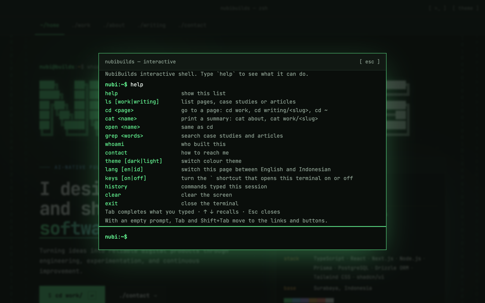
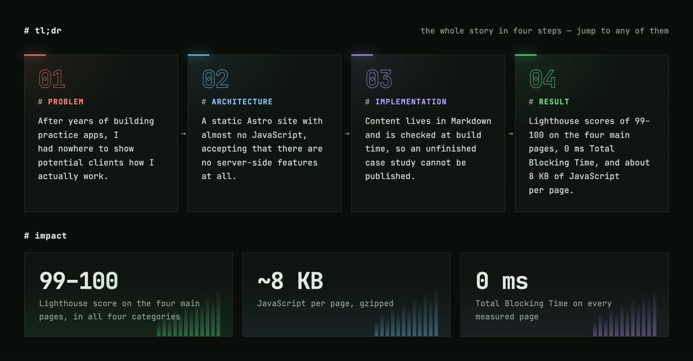
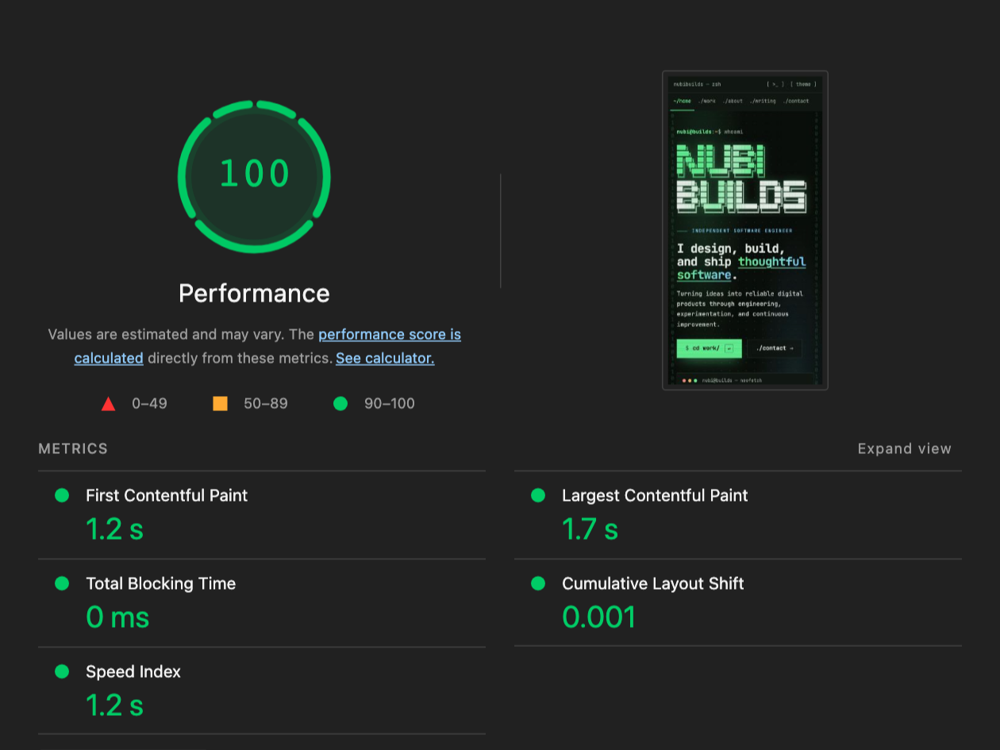

## Masalah

Saya mulai menulis kode di kampus tahun 2020. Sejak itu sudah banyak aplikasi yang saya buat, sebagian besar dari tutorial: satu proyek, satu konsep baru, lalu lanjut ke proyek berikutnya. Semuanya tersebar di repo yang hampir tidak pernah dilihat orang lain.

Sekarang saya membuka diri untuk proyek freelance, dan di situ masalahnya terasa. Kalau calon klien bertanya "pernah bikin apa, dan bagaimana cara kerjanya?", tautan GitHub saja tidak menjawab. Daftar repo hanya menunjukkan apa yang ada, bukan kenapa sebuah keputusan diambil.

Template portofolio siap pakai sebenarnya banyak. Tapi kebanyakan bentuknya mirip satu sama lain, berat di JavaScript, dan tidak dirancang untuk tulisan panjang. Yang saya butuhkan justru tempat untuk bercerita: masalahnya apa, apa yang saya pilih, dan apa hasilnya.

Ada satu syarat lagi. Sebagian calon klien saya berbahasa Indonesia, sebagian tidak. Studi kasus dan artikel harus bisa dibaca dalam dua bahasa tanpa saya harus mengurus dua situs.

**Batasan**

- Saya mengerjakannya sendirian, di sela pekerjaan lain. Merawat situs ini tidak boleh makan banyak waktu.
- Harus bisa di-host sebagai file statis biasa, tanpa server yang perlu dijaga atau dibayar.
- Harus cepat di ponsel dan bisa dipakai penuh dengan keyboard. Situs portofolio developer yang gagal di hal dasar seperti ini akan jadi bukti yang salah.

## Arsitektur

Bentuknya sederhana. Semua konten adalah file Markdown, Astro mengubahnya menjadi HTML statis saat build, dan hasilnya dilayani dari Cloudflare Pages. Tidak ada database, tidak ada API, tidak ada server yang berjalan. Prinsip yang saya pegang: halaman harus tetap terbaca utuh walaupun JavaScript mati.

```text
  src/content/{work,writing}/{en,id}/*.md
                   │
                   ▼
  content.config.ts   skema + cek struktur
                   │   (gagal → build berhenti)
                   ▼
  astro build
                   │
                   ▼
  dist/   HTML statis, ~8 KB JS per halaman
          + search.json, rss.xml, sitemap.xml, og/*.png
                   │
                   ▼
  Cloudflare Pages ──► browser
                       ├── tema, terminal, pencarian
                       └── tanpa JS: konten tetap terbaca
```

Bagian yang interaktif hanyalah tambahan. Terminalnya adalah elemen `<dialog>` biasa dengan 17 perintah (`ls`, `cd`, `grep`, `theme`, dan lain-lain) yang bisa dibuka dengan <kbd>Ctrl</kbd> + <kbd>K</kbd>. Pencariannya membaca `search.json` yang dibuat saat build, dan baru diunduh ketika pertama kali dipakai.



### Astro dan HTML statis, bukan Next.js

Next.js adalah alat yang saya pakai sehari-hari, jadi itu pilihan pertama yang terpikir. Tapi isi situs ini hampir seluruhnya teks. Mengirim runtime React ke browser hanya untuk menampilkan paragraf terasa berlebihan.

| Opsi | Kelebihan | Kenapa tidak dipilih |
| --- | --- | --- |
| Next.js | Paling saya kuasai | Runtime React ikut terkirim, padahal kontennya statis |
| Template portofolio | Cepat jadi | Sulit diubah, tidak cocok untuk tulisan panjang |
| Astro | HTML murni, JavaScript hanya jika diminta | Dipilih |

- **Alasan:** Astro menghasilkan HTML murni secara default. Script kecil yang saya tulis sendiri langsung di-inline ke halaman, tanpa framework di browser.
- **Konsekuensi:** Tidak ada fitur sisi server. Kontak cukup lewat email, dan pencarian berjalan di browser dari indeks JSON. Untuk puluhan entri itu lebih dari cukup. Kalau suatu hari jumlahnya ratusan, cara ini perlu ditinjau ulang.

### Satu folder per fitur

Kode dibagi per fitur: `home`, `work`, `writing`, `about`, `contact`, `terminal`, dan `search`. Halaman di `src/pages` hanya merangkai fitur-fitur itu. Satu aturan saya jaga ketat: sebuah fitur tidak boleh mengimpor fitur lain. Kode yang dipakai bersama tempatnya di `shared`.

- **Alasan:** Kalau ingin mengubah terminal, saya tahu persis folder mana yang harus dibuka, dan tidak ada bagian lain yang ikut rusak.
- **Konsekuensi:** Folder `shared` cenderung terus bertambah. Sesekali saya memeriksanya dan mengembalikan kode yang ternyata hanya dipakai satu fitur.

### Terjemahan ditentukan oleh nama file

Versi Inggris ada di folder `en/`, versi Indonesia di `id/`. Dua file dengan nama yang sama otomatis dianggap terjemahan satu sama lain. Tombol bahasa, sitemap, dan tag `hreflang` untuk mesin pencari mengikuti aturan itu tanpa konfigurasi tambahan.

- **Alasan:** Tidak perlu library i18n atau tabel pemetaan. Cukup salin file, lalu terjemahkan.
- **Konsekuensi:** Kedua versi harus saya jaga sendiri agar tetap sejalan. Beranda dan halaman About untuk sementara hanya tersedia dalam bahasa Inggris.

## Implementasi

### Build yang menolak konten setengah jadi

Saya kenal kebiasaan saya sendiri: menyalin template, mengisi separuhnya, lalu lupa. Jadi aturan menulis studi kasus tidak cukup ditulis di dokumentasi. Build-nya sendiri yang harus menolak.

Frontmatter diperiksa dengan skema Zod di `content.config.ts`. Field wajib yang kosong, atau teks penanda `TODO` yang tersisa dari template, langsung menggagalkan build. Isi tulisan juga dicek: harus diawali empat bagian `##` (Masalah, Arsitektur, Implementasi, Hasil) dan tidak boleh ada heading `#`. Pesan errornya menyebut file dan apa yang harus diperbaiki:

```text
src/content/work/id/nubibuilds: the body has 3 "##" section(s);
it must start with 4: Problem, Architecture, Implementation,
Result (Masalah, Arsitektur, Implementasi, Hasil). Fix it, or
set draft: true.
```

Ada satu jebakan kecil di sini. Komentar seperti `# install dependencies` di dalam blok kode shell terlihat persis seperti heading. Karena itu, baris di dalam blok kode dilewati dulu sebelum heading dihitung.

File dengan `draft: true` dikecualikan. Draft boleh berantakan selama apa pun, dan hanya tampil di `pnpm dev`.

Aturan yang ketat ini ada untungnya. Karena setiap studi kasus pasti punya empat bagian yang sama, halaman bisa menyusun ringkasan "tl;dr" sendiri dari frontmatter, dengan nomor dan warna yang konsisten. Setiap langkah langsung terhubung ke bagiannya.



### Fokus keyboard yang hilang dari layar

Bug yang paling bikin penasaran justru bug kecil. Supaya browser tidak bekerja sia-sia, setiap section di bawah layar pertama memakai `content-visibility: auto`. Browser melewati layout section itu sampai hampir terlihat, dan sementara itu memakai perkiraan tinggi 640px.

Lalu salah satu tes aksesibilitas mulai gagal, tapi tidak setiap kali. Tesnya sederhana: tekan <kbd>Tab</kbd> berulang kali dan pastikan setiap elemen yang mendapat fokus terlihat di layar. Kadang lolos, kadang tidak.

Penyebabnya ada di perkiraan tinggi tadi. Saat fokus masuk ke section yang belum di-layout, browser menggulir berdasarkan angka 640px. Begitu tinggi aslinya diketahui, elemen yang sedang difokus sudah terdorong ke bawah layar. Pengguna keyboard kehilangan jejak di mana mereka berada, dan ini melanggar WCAG 2.4.11.

Perbaikannya hanya beberapa baris. Dua frame setelah fokus berpindah, ketika layout sudah selesai, posisi elemen diperiksa ulang. Kalau ternyata ada di luar layar, elemen itu digulir kembali ke tempat yang terlihat:

```ts title="src/shared/ui/Section.astro" {4-5,8-9}
document.addEventListener('focusin', (event) => {
  const target = event.target;
  if (!(target instanceof HTMLElement) || !target.closest('.section')) return;
  requestAnimationFrame(() =>
    requestAnimationFrame(() => {
      if (document.activeElement !== target) return;
      const rect = target.getBoundingClientRect();
      if (rect.top >= window.innerHeight || rect.bottom <= 0)
        target.scrollIntoView({ block: 'nearest' });
    }),
  );
});
```

> [!NOTE]
> Syarat "seluruhnya di luar layar" itu penting. Blok kode yang panjang memang wajar hanya terlihat sebagian. Kalau setiap elemen yang terpotong ikut digulir, halaman akan melompat setiap kali <kbd>Tab</kbd> ditekan.

Tesnya juga saya sesuaikan: posisi elemen diukur ulang hingga 500 ms sebelum dinyatakan gagal. Sejak itu hasilnya stabil.

### Dikerjakan bersama Claude Code

Sebagian besar kode situs ini saya tulis bersama Claude Code. Saya yang menentukan arah, aturan, dan batasannya, lalu meninjau setiap perubahan sebelum di-commit. Claude mengerjakan banyak bagian yang repetitif dan ikut menelusuri bug seperti masalah fokus di atas. Tes end-to-end dan anggaran Lighthouse di CI memastikan kecepatan kerja itu tidak mengorbankan kualitas.

**Tahapan**

1. Pertengahan November 2026: kerangka situs, dua bahasa, terminal, pencarian, gambar pratinjau sosial, RSS, dan sitemap.
2. 20 November: commit pertama, lengkap dengan tes Playwright, pemindaian axe-core, dan anggaran Lighthouse di GitHub Actions.
3. 21 November: konten contoh dibuang, build mulai menolak studi kasus dan artikel yang belum lengkap, dan bug fokus diperbaiki.
4. 22 November: studi kasus ini terbit, yang pertama lolos lewat pemeriksaan tersebut.

## Hasil

Situs ini sekarang live di nubibuilds.dev. Angka-angkanya:

- Skor Lighthouse **99–100** untuk performa, aksesibilitas, best practices, dan SEO di beranda, `/work`, `/writing`, dan `/about`.[^1] Satu-satunya angka 99 ada di performa halaman About, yang memuat potret ASCII.
- **Total Blocking Time 0 ms** di keempat halaman itu. LCP berkisar antara 0,9 detik (`/work` dan `/writing`) dan 1,8 detik (`/about`).
- Sekitar **8 KB JavaScript** per halaman setelah gzip, di-inline langsung di HTML. Tidak ada file JavaScript eksternal yang perlu diunduh.[^2]
- **39 tes end-to-end**, masing-masing dijalankan di ukuran desktop dan ponsel, termasuk pemindaian axe-core untuk setiap halaman di tema gelap dan terang.



Buat saya, perubahan terbesarnya bukan di angka. Menambah studi kasus baru sekarang cukup dengan menyalin template, mengisinya, lalu menjalankan `pnpm build`. Kalau ada yang terlewat, build langsung memberi tahu file dan field mana yang bermasalah.

Yang belum bisa saya ukur justru hal yang paling penting: apakah situs ini benar-benar membantu mendatangkan klien. Itu baru bisa dinilai setelah beberapa bulan.

**Yang akan saya lakukan berikutnya**

- Menulis studi kasus untuk proyek lain, supaya halaman `/work` tidak hanya berisi situs ini sendiri.
- Memantau INP dan TTFB dari pengunjung sungguhan lewat Cloudflare Web Analytics. Dua angka itu tidak bisa diukur dengan Lighthouse di mesin lokal.
- Menerjemahkan beranda dan halaman About ke bahasa Indonesia.

[^1]: Diukur dengan Lighthouse CI (`pnpm lighthouse`) pada build produksi di mesin lokal, tiga kali per halaman, 20 November 2026.

[^2]: Diukur dari `dist/` hasil `pnpm build`: total isi tag `<script>` di beranda, `/work`, dan `/about` setelah dikompresi gzip, yaitu 7,2–7,8 KB.
